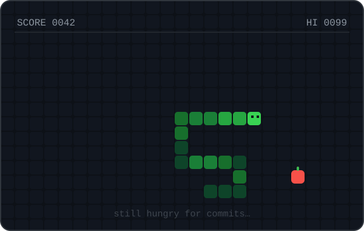

<picture>
  
</picture>

  
  
  

  

---

### 🧑‍💻 About me

- 🔭 I'm currently working on **web apps and automation tooling**
- 🌱 I'm currently learning **Rust** and **Kotlin**
- 💬 Ask me about **TypeScript, Python and Shell scripting**
- ⚡ Fun fact: this profile is **fully automated by GitHub Actions**

### 🐍 Contribution graph

<picture>
  <source media="(prefers-color-scheme: dark)" srcset="https://raw.githubusercontent.com/Dopetaiga/Dopetaiga/output/github-contribution-grid-snake-dark.svg" />
  <source media="(prefers-color-scheme: light)" srcset="https://raw.githubusercontent.com/Dopetaiga/Dopetaiga/output/github-contribution-grid-snake-light.svg" />
  
</picture>

### 🛠️ Tech stack

  

### 🖼️ Gallery

<!--
  📤 想放自己的图片？两步搞定：
  1. 把图片上传到本仓库的 assets/ 文件夹（GitHub 网页：进入 assets → Add file → Upload files）
  2. 把下面这行模板复制到 
 里，改成你的文件名：
     
-->

  
  

### 📊 GitHub metrics

  

<picture>
  
</picture>

  Made with ❤️ and GitHub Actions — last auto-update: <b>daily</b>

